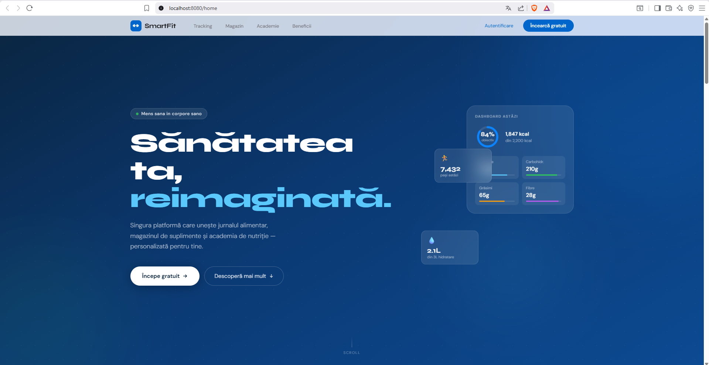
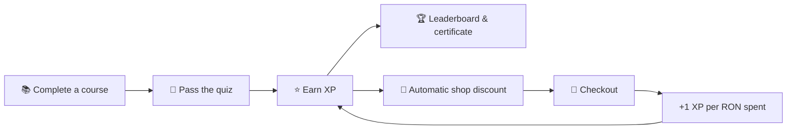
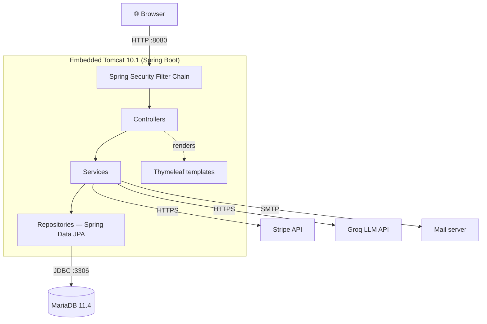
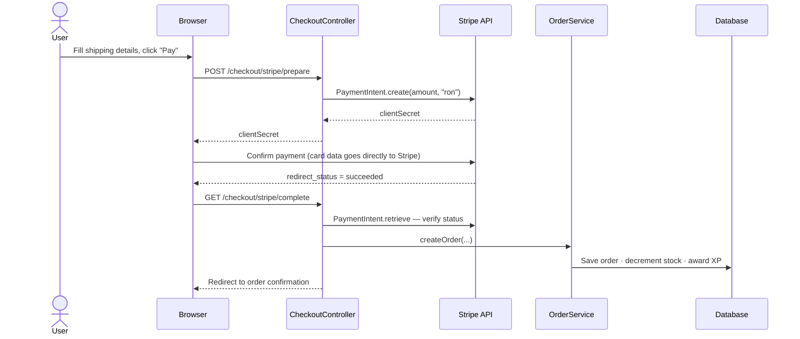
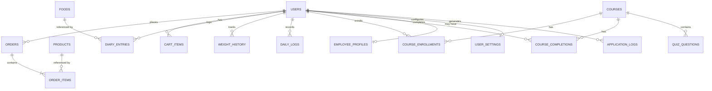

<div align="center">

# 💪 SmartFit

### One platform for **nutrition tracking**, **fitness e-commerce** and **gamified e-learning**

*Mens sana in corpore sano*




</div>

---

## 📖 Overview

Staying healthy means juggling several things at once: **tracking what you eat**, **buying the right supplements**, and **continuously learning** about fitness and nutrition. Today each of these lives in a separate app — users switch between platforms and correlate data by hand.

**SmartFit** unifies all three in a single full-stack web application and connects them with a gamification loop:  
**XP earned by passing course quizzes turns into real discounts in the shop — and every purchase earns more XP.**

> ⭐ Developed as my **Bachelor's thesis** at "Dunărea de Jos" University of Galați (Computer Science / CTI programme, graded **9.25 / 10**).  
> Covers the full development lifecycle: requirements, UML modelling, database design, implementation, security (OWASP Top 10) and automated testing.

---

## 🆚 How SmartFit compares

I analysed MyFitnessPal, Cronometer, Lifesum, Noom, MyProtein, iHerb, Udemy and Coursera — none of them combines all five pillars in one place.

|                  | Tracking | E-commerce | E-learning | Gamification | AI chatbot | Single platform |
|------------------|:--------:|:----------:|:----------:|:------------:|:----------:|:---------------:|
| MyFitnessPal     |    ✅    |     ❌     |     ❌     |   partial    |     ❌     |       ❌        |
| MyProtein        |    ❌    |     ✅     |     ❌     |   partial    |     ❌     |       ❌        |
| Udemy            |    ❌    |     ❌     |     ✅     |     ❌       |     ❌     |       ❌        |
| **SmartFit** 💪  |    ✅    |     ✅     |     ✅     |     ✅       |     ✅     |       ✅        |

---

## ✨ Features

### 🥗 Tracking & Wellness

- **Food diary** split by meal (breakfast / lunch / snack / dinner) — macros computed proportionally to quantity
- **BMR / TDEE calculator** using the Mifflin-St Jeor equation, five activity levels, and goal-based targets (lose weight / maintain / gain muscle)
- Weight log, daily steps, water intake and sleep tracking
- **30-day interactive charts** (Chart.js) with real-time macro and calorie progress against daily targets


---

### 🛒 E-commerce — SmartFit Shop

- Product catalogue with categories, keyword search, and price / rating / stock filters
- Shopping cart with live totals, automatic **XP discount** and free shipping above 200 RON
- **Stripe PaymentIntent** integration — card data never touches the server (PCI DSS compliant)
- Cash-on-delivery as an alternative payment method
- Automatic **PDF invoice** generation (iText) and **HTML confirmation email** (Spring Mail)
- Full order lifecycle: `PENDING → SHIPPED → DELIVERED / CANCELLED`


---

### 🎓 E-learning — SmartFit Academy

- Courses by difficulty (Beginner / Intermediate / Advanced) with embedded YouTube video, structured text and a multiple-choice quiz
- **Server-side quiz scoring** — results cannot be tampered with from the browser
- Passing a quiz awards **XP**, unlocks a **digital certificate** and moves the user up the **global leaderboard**


---

### 🤖 AI Fitness Assistant

An integrated chatbot specialised in fitness and nutrition, powered by the **Groq API (Llama 3)**. Contextual quick-suggestions are pre-populated based on the current page. API keys are used exclusively from the backend — never exposed to the client.

---

### 📊 Reports & Data Exports

Four report types: **nutrition summary, weight evolution, invoices & orders, academy progress** — each with a live preview and one-click export to **PDF, CSV, JSON and XML**.

---

### 🛡️ Administration & Audit

- Role-based panels for employees and admins: product / course CRUD, CSV bulk import, order management, user and employee management
- Sales and academy statistics dashboard
- Granular employee permissions (`can_create` / `can_edit` / `can_delete`) per department (SHOP or ACADEMY)
- **Full audit log**: every state-changing action records the user, role, entity, equivalent SQL, IP address, user-agent and timestamp

<table>
<tr>
<td></td>
<td></td>
</tr>
</table>

---

## 🔗 The XP → Discount Loop

The core idea of the project: **learning and shopping reinforce each other.**



Discount logic (simplified from `OrderService`):

```java
// 5% base discount, +1% per 100 XP, capped at 25%
int discountPct = Math.min(25, 5 + fitPoints / 100);
double shipping  = subtotal >= 200 ? 0 : 25;          // free shipping above 200 RON
double total     = subtotal - subtotal * discountPct / 100.0 + shipping;
```

Discounts are calculated and **validated server-side**. The entire order — items, stock decrement and XP award — runs inside a single `@Transactional` boundary, so any partial failure rolls everything back.

---

## 👥 User Roles

| Capability | Visitor | Client | Employee | Admin |
|---|:---:|:---:|:---:|:---:|
| Browse shop & course list | ✅ | ✅ | ✅ | ✅ |
| Food diary, BMR/TDEE, reports | ❌ | ✅ | ❌ | ✅ |
| Place orders, take quizzes, AI chatbot | ❌ | ✅ | ❌ | ✅ |
| Product CRUD & order processing | ❌ | ❌ | ✅ *(SHOP)* | ✅ |
| Course CRUD & academy reports | ❌ | ❌ | ✅ *(ACADEMY)* | ✅ |
| User & employee management | ❌ | ❌ | ❌ | ✅ |
| Full audit log | ❌ | ❌ | ❌ | ✅ |

---

## 🏗️ Architecture

Classic layered **MVC** architecture on Spring Boot, with Spring Security as a cross-cutting concern.



**Package structure:**

```
com.smartfit
├── config        SecurityConfig, WebConfig
├── controller    Main, Academie, Checkout, Admin, Angajat, Settings …
├── service       OrderService, PdfExportService, AuditLogService, ReportService …
├── repository    Spring Data JPA interfaces
├── entity        JPA entities (16 tables)
├── dto           CheckoutFormDto, CartItemDto …
└── util          BmrCalculator
```

Design principle: **controllers hold no business logic** — services own all rules, repositories only talk to the database.

---

### 💳 Payment Flow (Stripe)



---

### 🗄️ Database — 16 Relational Tables



---

## 🔐 Security — OWASP Top 10

| OWASP Risk | Mitigation in SmartFit |
|---|---|
| **A01** Broken Access Control | Role-based rules in Spring Security 6 (`/admin/**` → ADMIN, `/angajat/**` → EMPLOYEE/ADMIN), custom 403 page |
| **A02** Cryptographic Failures | Passwords stored only as **BCrypt** hashes (cost 10); card data handled exclusively by Stripe |
| **A03** Injection | Spring Data JPA with parameterised queries — no string-concatenated SQL |
| **A04** Insecure Design | Discounts, stock and quiz scores validated **server-side** |
| **A05** Security Misconfiguration | CSRF tokens (`CookieCsrfTokenRepository`), `HttpOnly` session cookie, session invalidated on logout |
| **A07** Auth Failures | Form login with failure redirect, session-based authentication |
| **A09** Logging Failures | Full audit trail: user, role, action, entity, equivalent SQL, IP, user-agent, timestamp |

**GDPR:** explicit consent at registration, data minimisation, right to erasure (admin account deletion), transparent privacy policy.

---

## 🧪 Testing

**43 automated tests — all passing** (JUnit 5 + Mockito + MockMvc), plus **17 documented manual end-to-end scenarios**.

| Test class | Tests | What it covers |
|---|:---:|---|
| `BmrCalculatorTest` | 10 | Mifflin-St Jeor values (male / female), `@CsvSource` parameterised profiles, edge cases, monotonicity |
| `UserServiceTest` | 4 | Persistence delegation, BMR integration, default fallback |
| `OrderServiceTest` | 5 | Totals with XP discount and shipping, stock decrement, address formatting, XP award |
| `CourseAdminServiceTest` | 10 | Course CRUD, quiz question replacement, search |
| `MainControllerTest` | 10 | HTTP status codes, redirects for protected pages, 403 for wrong role, registration flow |


---

## 🧰 Tech Stack

| Layer | Technology |
|---|---|
| Language | Java 21 (LTS) |
| Framework | Spring Boot 3.3.5 · Spring MVC 6.1 |
| Security | Spring Security 6.3 (BCrypt, CSRF, role-based access) |
| Persistence | Spring Data JPA · Hibernate 6.5 · MariaDB 11.4 |
| View | Thymeleaf 3.1 · HTML5 · CSS3 · Vanilla JavaScript · Chart.js |
| Payments | Stripe Java SDK 25.1 (PaymentIntents, RON) |
| Documents | iText 5 (PDF) · Apache POI (Excel) |
| Email | Spring Mail (SMTP) |
| AI | Groq API (Llama 3) |
| Testing | JUnit 5 · Mockito · MockMvc |
| Build & Tools | Maven · Lombok · IntelliJ IDEA |

---

## 🚀 Getting Started

### Prerequisites

- JDK 21
- Maven 3.9+
- MariaDB 11.x (or MySQL-compatible)
- Optional: Stripe test keys, SMTP credentials, Groq API key

### 1. Clone

```bash
git clone https://github.com/paulpietrisi/SmartFit.git
cd smartfit
```

### 2. Create the database

```sql
CREATE DATABASE smartfit_db
  CHARACTER SET utf8mb4
  COLLATE utf8mb4_unicode_ci;
```

Hibernate creates and updates the schema automatically (`ddl-auto=update`).

### 3. Configure secrets

Create `src/main/resources/application-local.properties` (**git-ignored — never commit real keys**):

```properties
spring.datasource.url=jdbc:mariadb://127.0.0.1:3306/smartfit_db?useUnicode=true&characterEncoding=UTF-8
spring.datasource.username=root
spring.datasource.password=YOUR_DB_PASSWORD

stripe.secret-key=sk_test_...
stripe.publishable-key=pk_test_...

spring.mail.host=smtp.mail.yahoo.com
spring.mail.port=587
spring.mail.username=you@example.com
spring.mail.password=YOUR_APP_PASSWORD

groq.api.key=YOUR_GROQ_KEY
```

Spring also accepts environment variables: `STRIPE_SECRET_KEY`, `SPRING_DATASOURCE_PASSWORD`, etc.

### 4. Run

```bash
mvn spring-boot:run -Dspring-boot.run.profiles=local
```

Open **http://localhost:8080**

### 5. Run the tests

```bash
mvn test
```

> 💳 Use Stripe's test card `4242 4242 4242 4242` with any future expiry date and any CVC.

---

## 🗺️ Roadmap

- [ ] Separate H2 in-memory profile for integration tests (no dependency on the main DB)
- [ ] Server-side pagination for product, order and log lists
- [ ] Docker / docker-compose setup and GitHub Actions CI/CD pipeline
- [ ] Migrate to a REST API with a React / Angular frontend
- [ ] Open Food Facts integration to extend the food database
- [ ] Personalised recommendations (collaborative filtering)
- [ ] Web push reminders (hydration, meals, weight log)
- [ ] Selenium / Playwright UI regression tests

---

## 👤 Author

**Paul-Valentin Pietriși** — Junior Java Backend / Full-Stack Developer, based in Iași, Romania

- 💼 [LinkedIn](https://linkedin.com/in/paul-valentin-pietriși-2260b4444)
- ✉️ paulpietrisi@yahoo.ro
- 🐙 GitHub: [@paulpietrisi](https://github.com/paulpietrisi)

Open to **junior Java / full-stack opportunities**. If you found this project useful, a ⭐ is always appreciated!

---

## 📄 License

Released under the [Apache License 2.0](LICENSE).
